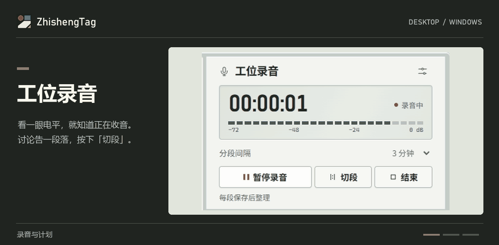
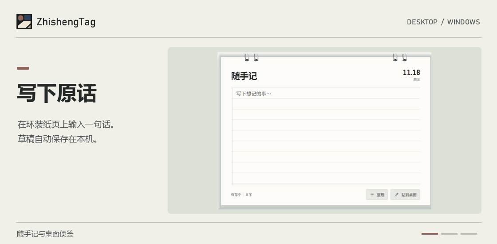

# ZhishengTag · 枳生Ai桌签

一个放在 Windows 工位上的环装便签本。左边随手写，右边持续录音，下面的时间轴陆续长出摘要。会议里说过的「明天下午三点发报价」，第二天可以直接在计划里勾掉，也可以点回去听当时的原话。

[开始使用](#start) · [随手记演示](#notes) · [接入模型](#models) · [使用手册](使用说明.md)

## 一段对话怎样进入计划

1. **先收下声音。** 麦克风电平和计时在工作台实时显示。默认每 3 分钟把一段音频存到本机，也可选 1、5 或 10 分钟。讨论提前结束时，点「切段」就能开始处理刚才那段，录音继续。
2. **给转写模型交代上下文。** 可以在录音设置里写下项目代号、人名和混用的语言。策略模型结合这些信息与相邻片段的转写，判断这一段适合会议纪要、口述待办、逐字记录还是多语转写，再把术语和语言提示交给支持这些参数的语音接口。
3. **边录边看结果。** 时间轴显示每段的转写与整理进度，摘要以流式方式更新。短期、长期事项和有依据的日期、时间会进入计划。打开事项能看到提取依据，从录音生成的待办还能回到对应片段。

录音使用单声道 Opus，目标码率约 24 kbit/s。开启「安静片段只存本机」后，静音段留在本地档案。网络或模型服务中断时，已保存的片段可以稍后重试。

## 一句话也可以是一张桌面便签

在「随手记」里输入文字，按 **Ctrl + Enter** 就能贴到桌面。点「整理」可以先核对摘要、重点和待办，再决定是否应用。独立便签也支持听写，可以插入原文或追加整理结果。便签簿支持搜索、置顶、回收站和从正文重新生成标题。

纸页、装订环和下沿的叠纸边缘在两种窗口里共用一套设计。窗口缩窄时，导航收成图标，纸面仍然可写，录音键也在手边。[窄窗口实拍](验证与预览/窄窗口工作台.png) · [界面与材质设计](DESIGN.md)

## 在 Windows 上运行

| Windows x64 下载 | 怎样启动 |
| --- | --- |
| [一键安装版 · EXE](https://github.com/zhishengplus/ZhishengTag/releases/download/v0.2.0/ZhishengTag-0.2.0-windows-x64-setup.exe) | 双击安装到当前用户，在桌面或开始菜单打开「枳生Ai桌签」。 |
| [免安装版 · ZIP](https://github.com/zhishengplus/ZhishengTag/releases/download/v0.2.0/ZhishengTag-0.2.0-windows-x64-portable.zip) | 将整个压缩包解压到同一目录，双击里面的 `ZhishengTag.exe`。 |

两个版本都自带运行环境，打开后即可打字、贴便签和分段录音。录音与便签默认保存在当前 Windows 用户的数据目录。版本记录和文件校验值见 [GitHub Releases](https://github.com/zhishengplus/ZhishengTag/releases)。从源码启动和构建请参阅[开发说明](README-开发.md)。

## 接入自己的模型

在左下角打开 **模型设置 → 服务商与模型**，填入自己的 API Key，点击「获取模型」选择账号可用的模型，或直接填写模型 ID。保存后进入「模型分工」启用所需的路线。

| 用途 | 可以怎样配 |
| --- | --- |
| 文字整理、标题与计划 | OpenAI、Anthropic Claude、DeepSeek、通义千问、豆包、Kimi、腾讯云、百度千帆、硅基流动、Gemini，或自定义兼容接口 |
| 转录策略 | 跟随文字整理模型，也可以单独指定一个已配置的文字模型 |
| 语音转写 | OpenAI、通义千问、硅基流动、Groq，或提供兼容转录接口的自定义服务 |

录音、便签和计划默认存放在 `%APPDATA%\ZhishengTag`。启用模型处理后，相关片段或文字会发送到选定服务商。API Key 由 Windows 的凭据加密机制在本机保存。服务商协议与模型目录的参考资料见[开发说明](README-开发.md)。

## 验证与许可

演示截自真实 Electron 窗口，使用示例文字、模拟麦克风和模型响应。Windows 回归覆盖了录音切段、失败重试、流式摘要、便签编辑、窄窗布局与进程重启恢复，共 22 项。长时使用的实际功耗和续航仍需在目标机器上测量。[测试报告](验证与预览/测试报告.json)

项目采用 MIT 许可，保留原「纸上便签」的版权署名。[许可证](LICENSE)
